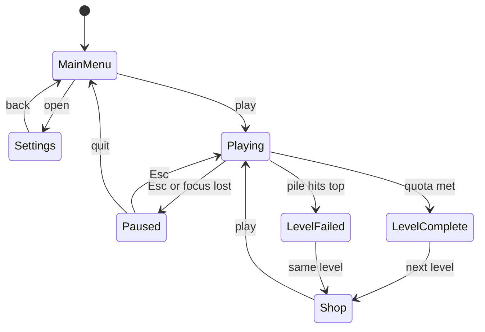

# Keystorm — SRS

## 1. Introduction

**Purpose.** This SRS defines Keystorm, a single-player falling-word typing game modelled on the original Typing Maniac (MetroGames, Facebook/iOS era). It is the reference for design, implementation and testing.

**Scope.** Words fall from the top of a play field; the player types them to clear them before they land. Missed words build a pile, and the level is failed when the pile reaches the top limit. The player earns coins during play and spends them in a shop between levels to buy and upgrade skills. Progress is saved: the player keeps their level, coins, skills and upgrades between sessions, and can retry a level as often as needed. The game is single-player only.

**Definitions.**

| Term       | Meaning                                                                                             |
| ---------- | --------------------------------------------------------------------------------------------------- |
| Word       | A falling text token the player must type                                                           |
| Pile       | Stack of landed words at the bottom of the play field                                               |
| Coins      | Currency earned in play, kept permanently and spent in the shop                                     |
| Skill      | An ability bought in the shop and fired by typing its name                                          |
| Tier       | A skill's efficiency level, I to III; higher tiers are stronger and cost more                       |
| Charge     | One use of a skill, earned by clearing one of its charge words and stored in the shared charge pool |
| Coin word  | A gold word that grants bonus coins when cleared                                                    |
| Black word | A hazard word that speeds up if the player mistypes                                                 |
| Quota      | Score needed to finish a level                                                                      |
| Attempt    | One play of the current level, ending in Level complete or Level failed                             |

**References.** The original game's public descriptions; IEEE 830-style SRS layout.

## 2. Overall description

**Product perspective.** A standalone browser game that runs fully client-side, with no server dependency for core play. The design should keep game logic separate from rendering so the engine can be unit-tested and later ported.

**Core design pillars.**

1. Typing is the input; triage is the skill. The player constantly decides which word to clear first.
2. Resource management. Coins are earned in play and spent on skills; choosing what to buy, upgrade and when to fire it is a core decision.
3. Accuracy over raw speed. Mistakes cost more than hesitation.
4. Rising pressure. Each level is faster and denser than the last.

**User classes.**

| User               | Needs                                                 |
| ------------------ | ----------------------------------------------------- |
| Casual player      | Pick up and play in under 30 s; clear feedback        |
| Typing learner     | Readable words, accuracy stats, adjustable difficulty |
| Competitive player | Fair, repeatable difficulty; personal records         |

**Operating environment.** Current desktop Chrome, Firefox, Safari and Edge with a physical keyboard. Minimum play-field resolution 1024 × 640.

**Constraints.**

- Original name, art, logos and word lists must not be copied; use the title Keystorm and original assets.
- English words only.
- No third-party tracking.

**Assumptions.**

- Players have a physical keyboard; mobile soft keyboards are not targeted.

**Technology stack.** React handles everything around the play field (menus, shop, HUD); the game loop runs in its own TypeScript engine so React never re-renders every frame.

| Layer                | Choice                                                        | Why                                                                     |
| -------------------- | ------------------------------------------------------------- | ----------------------------------------------------------------------- |
| Language             | TypeScript                                                    | Type safety across engine and UI                                        |
| UI and screens       | React                                                         | Menus, shop, HUD overlay and settings                                   |
| Build tool           | Vite                                                          | Fast dev server; outputs a static site                                  |
| Play field rendering | PixiJS (via @pixi/react)                                      | WebGL text and particle effects at 60 fps for skills like FIRE and BOMB |
| Game engine          | Plain TypeScript module with a fixed-step loop and seeded RNG | Testable without a browser (NFR-11) and independent of React            |
| Engine–UI state      | Zustand                                                       | Shares coins, combo and charges with React without per-frame re-renders |
| Styling              | Tailwind CSS                                                  | Quick, consistent styling for menus and shop                            |
| Audio                | Howler.js                                                     | Reliable cross-browser sound effects and music                          |
| Storage              | localStorage with a versioned schema                          | Saved progress and settings survive updates                             |
| Testing              | Vitest, React Testing Library, Playwright                     | Engine unit tests, UI tests, end-to-end runs                            |
| Hosting              | Static host (Vercel, Netlify or GitHub Pages)                 | No server needed                                                        |

## 3. Functional requirements

### 3.1 Word spawning and movement

| ID    | Requirement                                                                                |
| ----- | ------------------------------------------------------------------------------------------ |
| FR-01 | The system shall spawn words at random horizontal positions at the top of the play field.  |
| FR-02 | Spawn interval, fall speed and word length shall be set per level from a config table.     |
| FR-03 | Words shall not overlap horizontally with another word in the same vertical band at spawn. |
| FR-04 | No two words on screen shall share the same text.                                          |
| FR-05 | A word that reaches the top of the pile shall land and join the pile.                      |

### 3.2 Typing input and matching

| ID    | Requirement                                                                                                                       |
| ----- | --------------------------------------------------------------------------------------------------------------------------------- |
| FR-06 | The player shall type into a single input buffer shown on screen. Input stays free-form until submit and never locks onto a word. |
| FR-07 | Space or Enter shall submit the buffer; Backspace shall edit it.                                                                  |
| FR-08 | A submission matching an on-screen word (case-insensitive) shall clear that word.                                                 |
| FR-09 | While typing, on-screen words whose text starts with the buffer shall be highlighted.                                             |
| FR-10 | A submission matching no word and no skill name shall count as a mistake and clear the buffer.                                    |
| FR-11 | When several words could match, the lowest (most urgent) one shall be cleared.                                                    |

### 3.3 Pile and failing a level

| ID    | Requirement                                                                                                  |
| ----- | ------------------------------------------------------------------------------------------------------------ |
| FR-12 | Each landed word shall add one row-unit to the pile height.                                                  |
| FR-13 | Landing height for later words shall rise with the pile, shortening fall time.                               |
| FR-14 | The attempt shall fail when the pile reaches the danger line at the top; the player stays on the same level. |
| FR-15 | The pile shall reset to empty at the start of every attempt.                                                 |

### 3.4 Levels and progression

Keystorm is an endless climb with saved progress: the player always returns to the level they have reached and keeps trying until they pass it.

| ID    | Requirement                                                                                                                                                                                                                       |
| ----- | --------------------------------------------------------------------------------------------------------------------------------------------------------------------------------------------------------------------------------- |
| FR-16 | Levels shall continue without limit. Passing a level unlocks the next; failing keeps the player on the same level to retry.                                                                                                       |
| FR-17 | Each level shall have a score quota; reaching it ends the level. Level score exists only to track the quota.                                                                                                                      |
| FR-18 | Speed, spawn rate and word length shall rise per level from the config table, and extrapolate beyond its last row up to set caps.                                                                                                 |
| FR-19 | Words remaining on screen at level end shall be cleared without score.                                                                                                                                                            |
| FR-20 | The player's current level shall be saved and restored on launch; play resumes there by default. Players may also replay any earlier level from a level select; coins earned there are kept and the current level doesn't change. |

### 3.5 Scoring and combo

| ID    | Requirement                                                                                               |
| ----- | --------------------------------------------------------------------------------------------------------- |
| FR-21 | A cleared word shall score points proportional to its length, multiplied by the current combo multiplier. |
| FR-22 | Each correct submission shall add 1 to the combo counter; the multiplier rises by tier (table below).     |
| FR-23 | A mistake shall reset the combo to 0 and deduct a fixed penalty, never taking level score below 0.        |
| FR-24 | Skill activations shall neither add to nor break the combo.                                               |
| FR-25 | The HUD shall show the combo counter and multiplier, with feedback when a new tier is reached.            |

| Combo | Multiplier |
| ----- | ---------- |
| 0–4   | ×1         |
| 5–9   | ×1.5       |
| 10–19 | ×2         |
| 20–34 | ×2.5       |
| 35+   | ×3         |

A higher combo fills the quota faster, so accurate players clear levels sooner and face less pressure.

### 3.6 Coins

| ID    | Requirement                                                                                                                                    |
| ----- | ---------------------------------------------------------------------------------------------------------------------------------------------- |
| FR-26 | Each cleared word shall earn coins (e.g. 1 coin per word).                                                                                     |
| FR-27 | Gold coin words shall spawn at a per-level rate and grant bonus coins when cleared.                                                            |
| FR-28 | Completing a level shall grant a coin reward.                                                                                                  |
| FR-29 | Completing a level with zero mistakes shall grant a perfect-level coin reward on top (e.g. double the level reward).                           |
| FR-30 | Coins shall be kept permanently, including coins earned in a failed attempt, so a stuck player can earn more and buy skills to pass the level. |

### 3.7 Skills and the charge pool

Skills are unlocked and upgraded with coins in the shop. Charges come from charge words falling during play and go into one shared charge pool. A skill fires when the player types its name. Every unlocked skill is always available; there is no loadout.

| ID    | Requirement                                                                                                                                                                              |
| ----- | ---------------------------------------------------------------------------------------------------------------------------------------------------------------------------------------- |
| FR-31 | The shop shall offer the 14 skills listed below; buying a skill unlocks it at Tier I.                                                                                                    |
| FR-32 | Each skill shall be upgradable to Tier II and Tier III; each tier shall cost more than the one before.                                                                                   |
| FR-33 | Each skill shall have charge words: ordinary words marked with that skill's colour and icon. Clearing one adds a charge of that skill to the pool.                                       |
| FR-34 | Charge words shall spawn only for skills the player has unlocked, at a per-level rate.                                                                                                   |
| FR-35 | The charge pool shall hold any mix of skill charges up to its capacity (base 5). When full, a cleared charge word adds nothing. The pool starts empty at the beginning of every attempt. |
| FR-36 | Typing a skill's name and submitting it shall spend one charge of that skill from the pool and fire it at its current tier, with its weather effect (see section 6).                     |
| FR-37 | Skill names shall never appear as ordinary falling words.                                                                                                                                |
| FR-38 | Submitting the name of a locked skill or one with no charge in the pool shall show brief "no charge" feedback and not count as a mistake.                                                |
| FR-39 | Timed effects of the same skill shall not stack; firing it again while active resets its timer.                                                                                          |
| FR-40 | The HUD shall show the pool as a row of slots coloured by skill, with each skill's name and count.                                                                                       |

**Skill effects by function and tier.** Values are starting points for playtesting.

_Clear words_

| Skill | Effect                                                          | Tier I         | Tier II              | Tier III             |
| ----- | --------------------------------------------------------------- | -------------- | -------------------- | -------------------- |
| FIRE  | Burns away falling words                                        | 3 lowest words | Lowest half of words | Every word on screen |
| BOMB  | The next word cleared explodes, clearing words around it        | 80 px radius   | 140 px radius        | 200 px radius        |
| CHAIN | Clearing a word also clears words starting with the same letter | 5 s            | 8 s                  | 12 s                 |

_Buy time_

| Skill  | Effect                                       | Tier I            | Tier II        | Tier III        |
| ------ | -------------------------------------------- | ----------------- | -------------- | --------------- |
| ICE    | Freezes all falling words                    | 2 s               | 4 s            | 6 s             |
| SLOW   | Slows falling words                          | 70% speed, 5 s    | 50% speed, 7 s | 35% speed, 10 s |
| REWIND | Pushes all falling words back up the screen  | 25% of the height | 50%            | Back to the top |
| SHRINK | Trims on-screen words to their first letters | First 4 letters   | First 3        | First 2         |

_Protect the pile_

| Skill  | Effect                                      | Tier I | Tier II | Tier III |
| ------ | ------------------------------------------- | ------ | ------- | -------- |
| WIND   | Removes rows from the pile                  | 1 row  | 2 rows  | 4 rows   |
| SHIELD | The next landed words don't add to the pile | 1 word | 2 words | 3 words  |

_Economy_

| Skill  | Effect                                              | Tier I       | Tier II       | Tier III      |
| ------ | --------------------------------------------------- | ------------ | ------------- | ------------- |
| MAGNET | Coin and charge words drift down to the typing line | 8 s          | 12 s          | 16 s          |
| DOUBLE | Score and coins ×2                                  | Next 5 words | Next 10 words | Next 15 words |
| LUCK   | More charge words spawn for the rest of the level   | +25%         | +50%          | +100%         |

_Risk and reward_

| Skill     | Effect                                        | Tier I     | Tier II    | Tier III    |
| --------- | --------------------------------------------- | ---------- | ---------- | ----------- |
| OVERDRIVE | Words fall 50% faster but score is multiplied | ×2 for 6 s | ×3 for 8 s | ×4 for 10 s |
| GAMBLE    | Fires a random other skill, unlocked or not   | At Tier I  | At Tier II | At Tier III |

### 3.8 Shop and upgrades

| ID    | Requirement                                                                                                             |
| ----- | ----------------------------------------------------------------------------------------------------------------------- |
| FR-41 | The shop shall open after every attempt, passed or failed, and be reachable from the main menu.                         |
| FR-42 | The shop shall have two tabs: Skills (unlock and upgrade) and Upgrades (passive perks bought in ranks).                 |
| FR-43 | The shop shall show current tier or rank, the next effect and the price, and disable anything the player cannot afford. |
| FR-44 | Unlocked skills, tiers and upgrades shall be permanent.                                                                 |

**Upgrades.** Passive perks that make the game easier to manage. Values are starting points for playtesting.

| Upgrade          | Effect per rank                                            | Max rank |
| ---------------- | ---------------------------------------------------------- | -------- |
| Charge capacity  | +2 charge pool slots                                       | 5        |
| Reinforced floor | Raises the danger line by 1 pile row                       | 3        |
| Steady hands     | Forgives 1 mistake per level (no penalty, combo kept)      | 3        |
| Combo keeper     | A mistake drops the combo one tier instead of resetting it | 1        |
| Quick cast       | Skills fire from the first 3 letters of their name         | 1        |
| Coin bonus       | +10% coins from all sources                                | 5        |
| Lucky draw       | +10% charge word spawn rate                                | 3        |
| Head start       | Start each level with 1 random charge of an unlocked skill | 2        |
| Danger radar     | Highlights the word closest to landing                     | 1        |

With Quick cast, an exact match to an on-screen word takes priority over a skill prefix.

### 3.9 Hazard words

- FR-45: Black words shall spawn at a per-level rate.
- FR-46: A mistake made while a black word is on screen shall multiply that word's fall speed (e.g. ×2).

### 3.10 Game states and controls

- FR-47: The game shall support the states Main menu, Playing, Paused, Level complete, Shop, Level failed and Settings (see section 6).
- FR-48: Esc shall pause and resume; the field shall be hidden while paused.
- FR-49: The game shall auto-pause when the window loses focus.

### 3.11 Persistence and stats

- FR-50: Progress (current level, coins, unlocked skills and tiers, upgrades and personal records) shall be saved locally after every attempt and shop purchase, and restored on launch.
- FR-51: End-of-attempt stats shall show level score against the quota, WPM, accuracy %, highest combo, words cleared, coins earned and skills used.
- FR-52: Settings (volume, difficulty, word list, reduced motion) shall persist between sessions. Settings shall include a reset-progress option that asks for confirmation.

## 4. Non-functional requirements

| ID     | Area            | Requirement                                                                       |
| ------ | --------------- | --------------------------------------------------------------------------------- |
| NFR-01 | Performance     | Render at a steady 60 fps with up to 30 words on screen.                          |
| NFR-02 | Performance     | Keystroke-to-screen latency under 16 ms.                                          |
| NFR-03 | Performance     | Initial load under 3 s on a 10 Mbps connection.                                   |
| NFR-04 | Fairness        | Movement shall use delta time so speed is identical at any frame rate.            |
| NFR-05 | Usability       | A player can start playing within 2 clicks from launch.                           |
| NFR-06 | Usability       | Words shall be at least 18 px, high-contrast, in a monospaced or clear sans font. |
| NFR-07 | Accessibility   | Special-word types shall be distinguishable by icon or outline, not colour alone. |
| NFR-08 | Accessibility   | A reduced-motion mode shall disable screen shake and particle effects.            |
| NFR-09 | Reliability     | Lost focus or tab switch shall never lose an in-progress attempt (auto-pause).    |
| NFR-10 | Maintainability | Difficulty curves and word lists shall live in data files, not code.              |
| NFR-11 | Testability     | Game logic shall run headless with a seedable RNG for repeatable tests.           |
| NFR-12 | Portability     | No browser-specific APIs without a fallback.                                      |

## 5. Data requirements

**Word list.** A JSON or text file of at least 3,000 common English words, bucketed by length (3–4, 5–6, 7–8, 9+ letters). Profanity and all skill names are filtered out.

**Level config.** One row per level; levels beyond the table extrapolate from the last row.

| Field            | Type        | Example (level 1) |
| ---------------- | ----------- | ----------------- |
| level            | int         | 1                 |
| quota            | int, points | 500               |
| fallSpeed        | float, px/s | 40                |
| spawnInterval    | float, s    | 2.0               |
| wordLengthRange  | [min, max]  | [3, 5]            |
| coinWordChance   | float, 0–1  | 0.10              |
| blackChance      | float, 0–1  | 0.00              |
| chargeWordChance | float, 0–1  | 0.08              |

Example values are starting points for playtesting, not final tuning.

**Skill config.** Per skill: colour, icon, activation name, and per tier its effect (duration in s, speed factor, words cleared or pile rows removed) and prices.

**Shop prices (coins).** Starting values for playtesting; each step up costs more than the last.

| Action                    | Tier I | Tier II | Tier III |
| ------------------------- | ------ | ------- | -------- |
| Unlock or upgrade to tier | 30     | 80      | 180      |

**Coin rewards.** Coins per cleared word, coin-word bonus, level-complete reward and perfect-level reward, all set in config.

**Upgrade prices (coins).** Each rank costs more than the last, e.g. 40, 90, 160, 250, 360 for ranks 1–5. Single-rank upgrades (Combo keeper, Quick cast, Danger radar) cost 150.

**Gameplay config.** Base charge pool capacity (5), combo tiers and multipliers, mistake penalty, and per-level caps for speed and spawn rate.

**Save data (localStorage).**

- `progress`: {currentLevel, coins, skills (tier per skill), upgrades (rank per upgrade), records (best combo, best WPM)}.
- `settings`: {volume, difficulty, wordList, reducedMotion}.

## 6. UI screens and flow

Every attempt ends in Level complete or Level failed, and either way leads to the Shop before the next attempt; Esc or losing focus pauses at any point.

| Screen         | Contents                                                                                                                                                                             |
| -------------- | ------------------------------------------------------------------------------------------------------------------------------------------------------------------------------------ |
| Main menu      | Title, current level, Play, Level select, Shop, Records, Settings                                                                                                                    |
| Playing (HUD)  | Play field, pile, input buffer, score, level, quota bar, coin balance, charge pool slots coloured by skill with names and counts, combo counter and multiplier, active-effect timers |
| Paused         | Field hidden; Resume, Restart, Quit                                                                                                                                                  |
| Level complete | Level score, accuracy, coins earned, perfect-level coins, Continue to shop                                                                                                           |
| Shop           | Coin balance; Skills tab (grouped by function, each with tier and an Unlock/Upgrade button with price); Upgrades tab (each perk's rank, effect and price); Start next level          |
| Level failed   | Level score against quota, highest combo, WPM, accuracy, coins earned (kept); Retry, Shop, Menu                                                                                      |
| Settings       | Volume, difficulty, word list, reduced motion                                                                                                                                        |

**Visual theme: storm and weather.** Words fall like rain from a dark storm sky and the pile rises at the bottom like floodwater. Coin words glow gold like lightning; black words are drawn as thunderclouds. Each skill turns the background into its own weather while it fires. With reduced motion on, effects become a static colour tint.

| Skill     | Weather effect                                                        |
| --------- | --------------------------------------------------------------------- |
| FIRE      | Sky turns red; flames and embers sweep across and burn the words away |
| BOMB      | Thunderclap; lightning strikes the target word with a shockwave       |
| CHAIN     | Forked lightning jumps between the matching words                     |
| ICE       | Blizzard blue; frost creeps over the screen and words freeze in ice   |
| SLOW      | Thick fog rolls in and the rain falls in slow motion                  |
| REWIND    | The wind reverses and the rain flies back upward                      |
| SHRINK    | Hailstones chip letters off the words                                 |
| WIND      | A gale sweeps across and blows the pile away                          |
| SHIELD    | A glowing dome covers the pile                                        |
| MAGNET    | A funnel cloud pulls coin and charge words down                       |
| DOUBLE    | A double rainbow arcs across the sky                                  |
| LUCK      | The sun breaks through the clouds in golden light                     |
| OVERDRIVE | Hurricane: torrential rain and red warning flashes                    |
| GAMBLE    | A tornado spins, then reveals the chosen skill's weather              |
